<div align="center">


# 발자국

**조별과제 과정기록 & 평가지원 서비스**

누가 언제 무엇을 했는지 시각까지 남기고, 동료평가 때 그 기록을 근거로 보여 줌

[](https://github.com/Pyrite9/footprint-demo/actions/workflows/ci.yml)      [](LICENSE)

[빠른 시작](#빠른-시작) · [주요 기능](#주요-기능) · [화면](#화면) · [기술 스택](#기술-스택) · [문서](#문서)

</div>

<br>

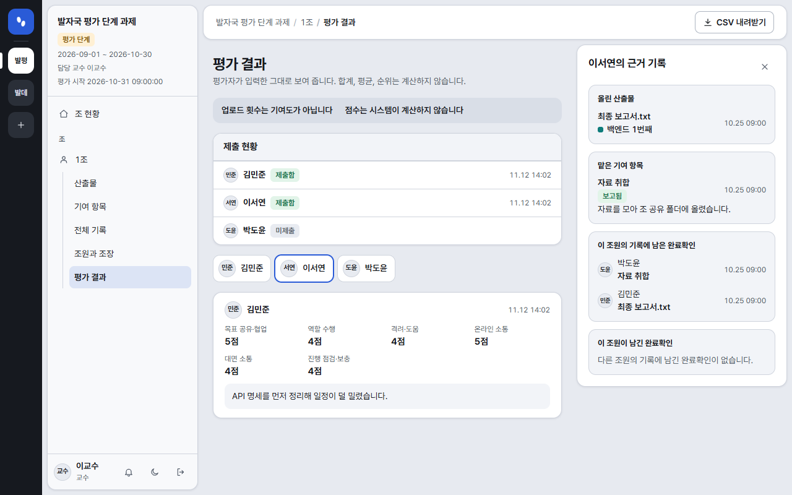

## 발자국은

> [!IMPORTANT]
> **판단은 사람, 시스템은 근거만**
>
> 점수, 평균, 합계, 순위, 진척률을 계산하지 않음. 기록을 있는 그대로 보여 주고 판단은 조원과 교수가 함

| 조별과제에서 흔한 일 | 발자국의 방법 |
|---|---|
| 누가 무엇을 했는지 말로만 남음 | 산출물 업로드, 기여 항목, 역할 변경을 서버가 정한 시각과 함께 기록함 |
| 고친 파일이 덮어써져 과정이 사라짐 | 고친 파일도 새로 올리고 역할별 순번을 붙임. 지워도 "삭제됨"으로 줄이 남음 |
| 회의, 자료 취합처럼 파일이 남지 않는 일이 묻힘 | 기여 항목으로 담당 조원과 완료 보고 메모를 남김 |
| 기록이 사실인지 알기 어려움 | 다른 조원이 기록마다 완료확인을 남기고, 취소해도 이력에 남음 |
| 동료평가가 인상으로 매겨짐 | 평가 화면 옆에 그 조원의 근거 기록을 함께 띄움 |
| 업로드 횟수가 기여도로 오해됨 | 건수와 진척률을 세지 않고 "업로드 횟수는 기여도가 아닙니다"를 화면에 고정함 |

## 주요 기능

- **과정 기록** — 역할별 순번이 붙는 산출물 업로드, 기여 항목과 완료 보고, 역할·조장 교체 이력
- **서로 확인** — 기록 한 건씩 남기는 완료확인, 조의 모든 기록을 시간순·조원별로 보는 타임라인, 과제 기간 위 역할별 업로드 시점
- **근거 있는 평가** — 행동기준평정척도(신태섭 2018) 6개 항목 동료평가, 임시 저장, 근거 패널, 교수용 평가 결과와 CSV
- **조 운영** — 교수의 과제·조·조장 생성, 초대 링크와 합류 전 미리보기, 역할 배정, 평가 단계 전환, 화면 안 알림
- **학교 계정** — 학교 구글 계정(g.yju.ac.kr) 로그인, 개인정보 고지와 동의
- **바로 실행** — `docker compose` 한 번으로 전체 실행, 인터넷 없이 켜지는 제출용 묶음, 백업·복구 스크립트

## 사용 흐름

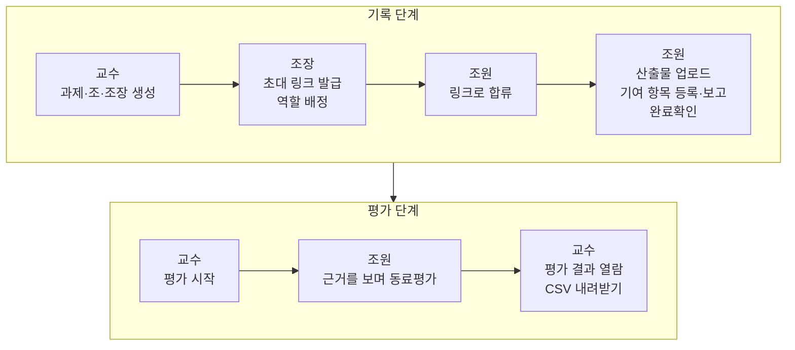

- 기록 단계에서 평가 단계로는 과제를 만든 교수만 바꾸고, 되돌릴 수 없음
- 평가 단계에서는 기록을 새로 쓰지 못하고 열람만 함

## 화면

<table>
  <tr>
    <td width="50%">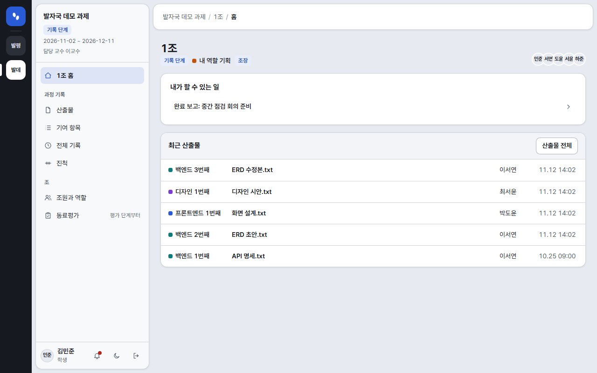<p align="center"><b>조 홈</b> — 내가 할 일과 최근 산출물</p></td>
    <td width="50%">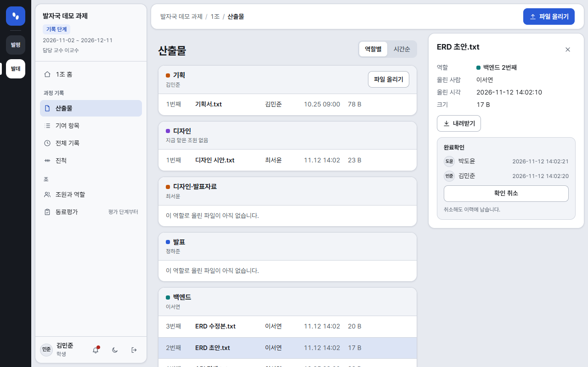<p align="center"><b>산출물</b> — 역할별 순번과 완료확인</p></td>
  </tr>
  <tr>
    <td width="50%">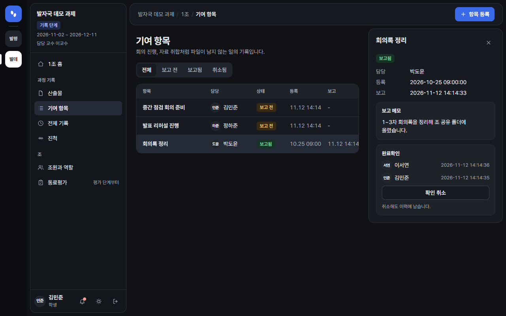<p align="center"><b>기여 항목</b> — 파일이 남지 않는 일의 기록</p></td>
    <td width="50%">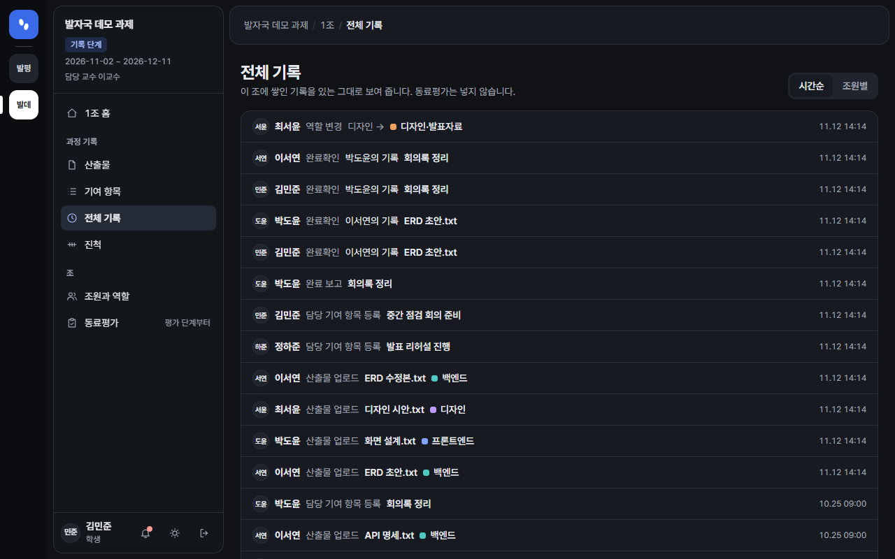<p align="center"><b>전체 기록</b> — 조의 기록을 있는 그대로</p></td>
  </tr>
  <tr>
    <td width="50%">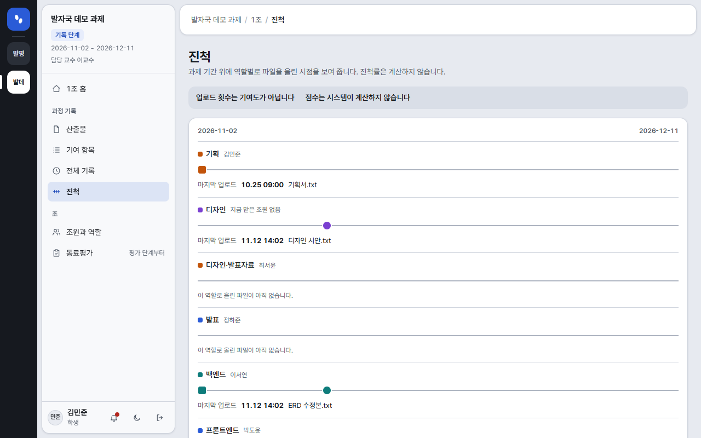<p align="center"><b>진척</b> — 과제 기간 위 역할별 업로드 시점</p></td>
    <td width="50%">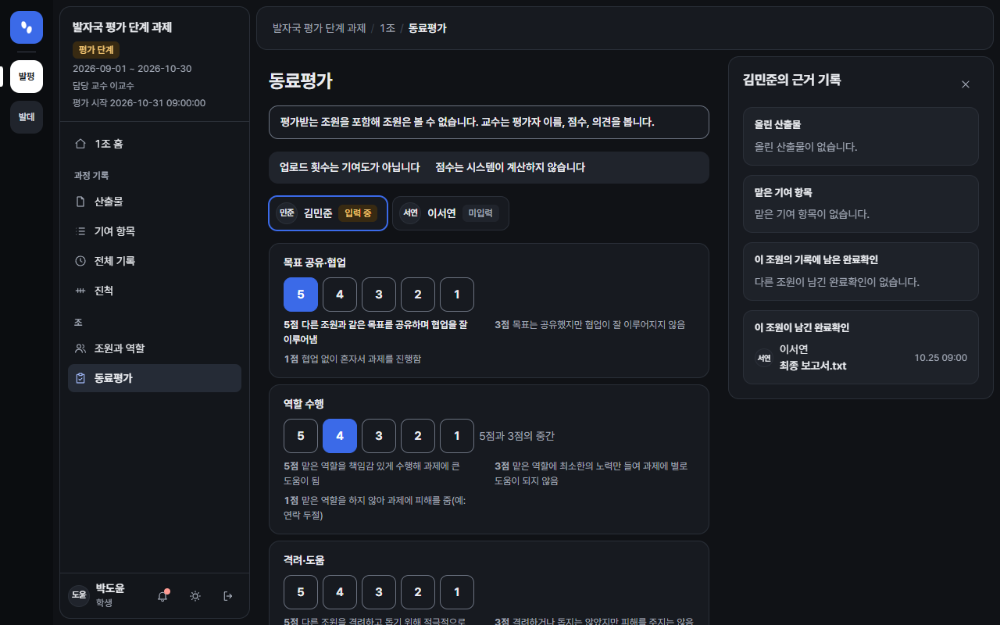<p align="center"><b>동료평가</b> — 6개 항목과 근거 패널</p></td>
  </tr>
</table>

### 화면별 설명

- 화면 17개와 화면 밖의 기능을 펼쳐 봄. 기능 번호(M-1, A-1 등)는 업무 기능도 및 업무 기술서 v1.3과 `TODO.md`의 추가 기능 번호임
- 사진은 가짜 API(`frontend` 폴더의 `npm run mock`)의 시작 데이터에 업로드, 기여 항목, 완료확인, 역할 변경, 평가 제출 몇 건을 더해 찍음(2026.11.12, 1280×800, 다크 테마)
- 이름과 이메일은 모두 시작 데이터의 가짜 값임. 계정 표는 `backend/README.md`의 "시작 계정"
- 화면 맨 왼쪽 세로줄은 내 과제 목록(과제 이름 앞 두 글자), 그 옆은 고른 과제·조의 메뉴, 메뉴 맨 아래는 내 이름·알림·테마 전환(라이트·다크)·로그아웃

| 기능 | 화면 |
|---|---|
| M-1 회원 등록, M-2 로그인·로그아웃, X-1 교수 유형 변경 | 1. 로그인 |
| X-2 개인정보 고지와 동의 | 2. 개인정보 고지 |
| A-1 과제 생성, A-2 과제 목록·상세 | 3. 내 과제, 4. 새 과제, 5. 조 현황 |
| A-3 평가 시작 | 5. 조 현황 |
| T-1 조원 초대, X-4 합류 전 미리보기·링크 복사 | 7. 조원과 역할, 8. 초대 링크로 합류 |
| T-2 역할 배정 | 7. 조원과 역할 |
| X-3 조장 교체 | 9. 조장 교체 |
| R-1 산출물 업로드·열람 | 10. 산출물, 11. 산출물 상세 |
| R-3 완료확인 | 11. 산출물 상세와 완료확인, 12. 기여 항목 |
| R-2 기여 항목 | 12. 기여 항목 |
| V-1 조별 기록 열람 | 13. 전체 기록 |
| R-4 진척 시각화 | 14. 진척 |
| E-2 동료평가 입력, E-1 근거 패널 | 15. 동료평가와 근거 패널 |
| V-2 평가 결과 열람, X-5 평가 결과 CSV | 16. 평가 결과 |
| X-6 화면 안 알림 | 17. 알림 |
| X-7, O-1~O-8 | 화면 밖의 기능 |

<details>
<summary><b>1. 로그인</b></summary>

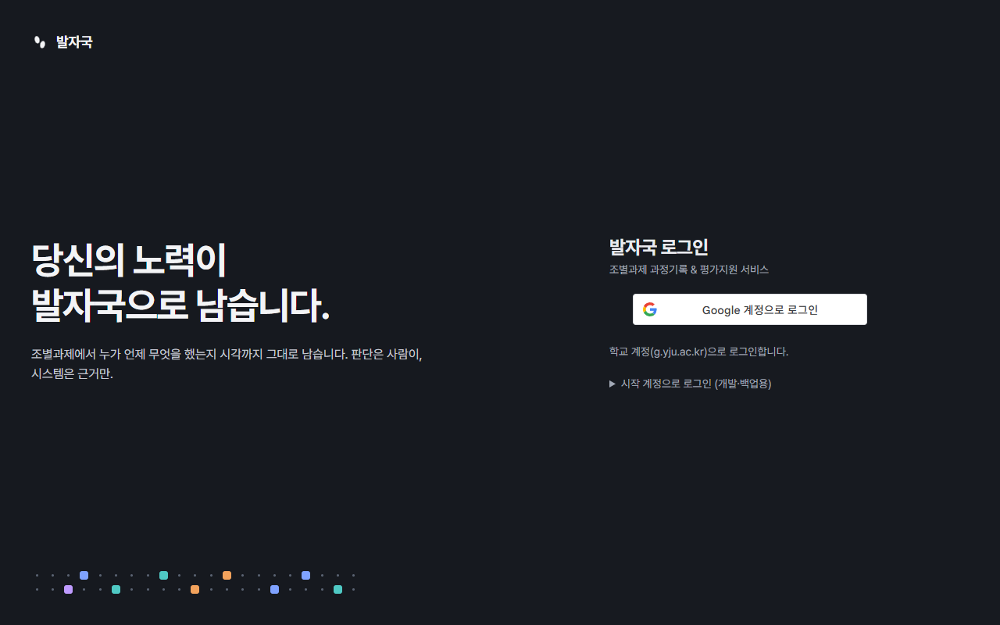

- 학교 구글 계정(g.yju.ac.kr)으로 로그인함. 처음 로그인한 구글 계정은 회원으로 저장됨(M-1을 이것으로 대신함)
- "시작 계정으로 로그인 (개발·백업용)"을 펼치면 이메일·비밀번호 로그인. 운영 설정(`prod`)에서는 꺼짐
- 회원 유형은 교수, 학생 둘. 구글 로그인할 때마다 교수 이메일 목록(`PROFESSOR_EMAILS`)에 있는 학생을 교수로 올림(X-1). 조 참여 기록이 있는 학생은 올리지 않고, 교수를 학생으로 내리지 않음
- 로그인은 access token(10분, 화면의 메모리)과 refresh token(24시간, `HttpOnly` cookie)으로 유지됨. 새로고침해도 로그인이 남고, 로그인한 지 24시간이 지나면 다시 로그인함
- 같은 브라우저의 탭은 로그인을 함께 씀. 교수와 학생을 동시에 보려면 브라우저를 둘 쓰거나 한쪽을 시크릿 창으로 엶

</details>

<details>
<summary><b>2. 개인정보 고지</b></summary>

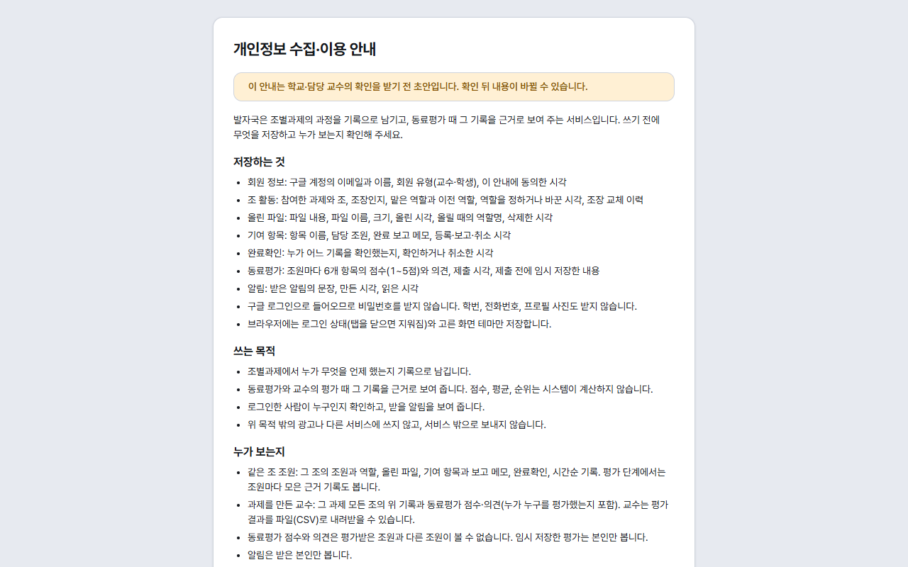

- 첫 로그인 뒤 고지 화면이 먼저 나옴. 동의하기 전에는 다른 화면으로 가지 못함
- 동의하면 동의 시각을 서버가 저장함. 다시 동의해도 처음 시각을 둠
- 저장하는 것, 쓰는 목적, 누가 보는지, 보관 기간을 적음
- 문구와 보관 기간은 학교·담당 교수 확인 전 초안임(`frontend/src/constants/privacyNotice.js`). 화면 맨 위에 초안이라는 안내가 있음

</details>

<details>
<summary><b>3. 내 과제</b></summary>

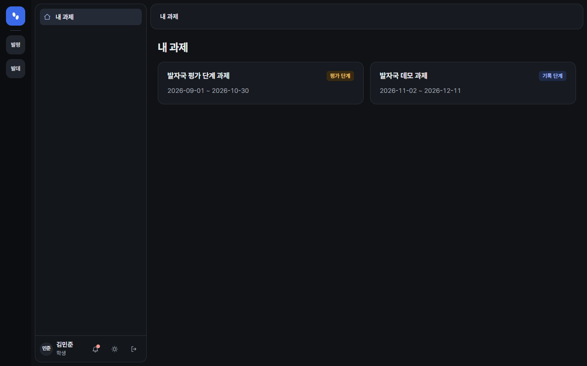

- 로그인한 회원이 참여한 과제(교수는 만든 과제)를 카드로 보여 줌
- 카드마다 과제 이름, 기간, 단계(기록 단계·평가 단계)
- 카드를 누르면 학생은 자기 조 홈으로, 교수는 조 현황으로 감

</details>

<details>
<summary><b>4. 새 과제 (교수)</b></summary>

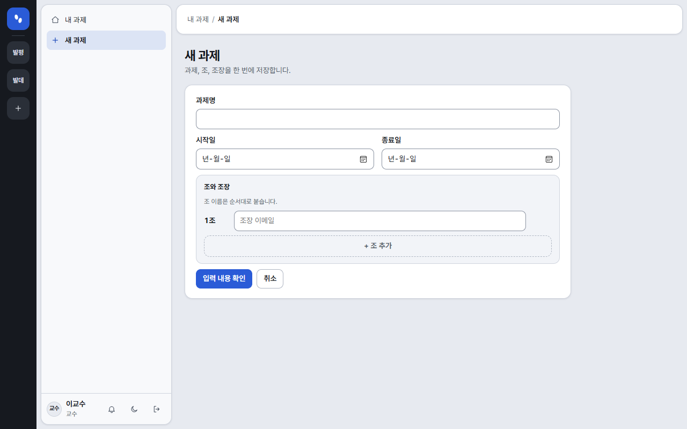

- 교수만 만듦. 과제명, 시작일, 종료일, 조마다 조장 이메일을 넣음
- 조 이름은 순서대로 붙음(1조, 2조…). "조 추가"로 조를 늘림
- "입력 내용 확인"을 누르면 한 번 더 보여 주고, 확정하면 과제·조·조장을 한 번에 저장함
- 등록한 과제는 고치거나 지울 수 없음

</details>

<details>
<summary><b>5. 조 현황과 평가 시작 (교수)</b></summary>

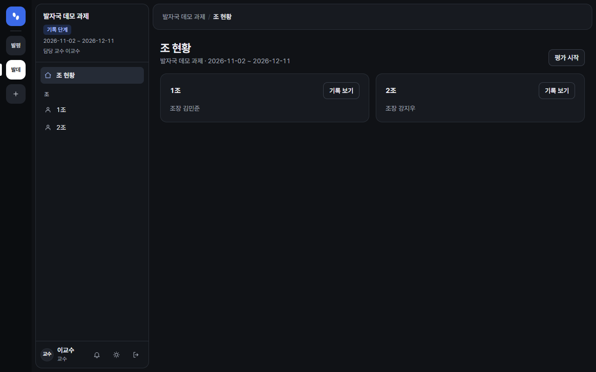

- 과제를 만든 교수가 보는 과제 상세. 조마다 조장 이름과 "기록 보기"
- 왼쪽 메뉴에서 조를 펼치면 그 조의 산출물, 기여 항목, 전체 기록, 조원과 조장, 평가 결과로 감
- "평가 시작"(A-3): 과제를 기록 단계에서 평가 단계로 바꿈. 되돌릴 수 없음
  - 평가 단계에서는 조 운영과 과정 기록의 쓰기를 막고 열람은 그대로 둠
  - 그 과제 모든 조의 조원에게 알림이 감
- 과제 기간이 지나도 단계를 저절로 바꾸지 않음

</details>

<details>
<summary><b>6. 조 홈</b></summary>


- 조원이 과제를 고르면 처음 보는 화면. 조 이름, 단계, 내 역할, 조장 표시, 조원 이름
- "내가 할 수 있는 일": 지금 내가 할 일을 기록에서 골라 보여 줌. 누르면 그 화면에서 해당 줄을 바로 엶
  - 예: 초대 링크 발급(조장), 역할 지정(조장), 맡은 기여 항목의 완료 보고
- "최근 산출물": 최근에 올라온 파일. "산출물 전체"로 목록 화면에 감

</details>

<details>
<summary><b>7. 조원과 역할</b></summary>

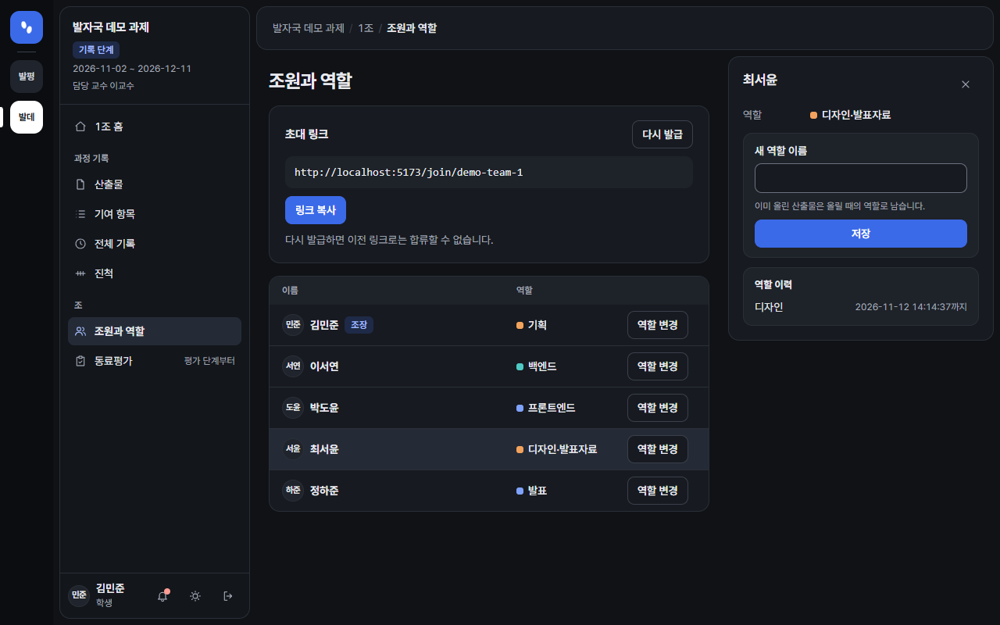

- 초대 링크(T-1, X-4): 조장만 발급함
  - "링크 복사"로 링크를 복사해 조원에게 보냄
  - "다시 발급"하면 이전 링크로는 합류할 수 없음
- 역할 배정(T-2): 조장이 조원마다 역할명 하나를 정함. 같은 역할을 여러 조원이 맡을 수 있음
  - "역할 변경"을 누르면 오른쪽에 새 역할 입력과 그 조원의 역할 이력이 열림
  - 바꾸면 이전 역할명과 바뀐 시각이 이력으로 남음. 이력은 고치거나 지울 수 없음
  - 이미 올린 산출물은 올릴 때의 역할로 남음. 역할이 바뀌어도 산출물 순번이 끊기지 않음
- 조장이 아닌 조원은 조원 목록과 이력만 봄

</details>

<details>
<summary><b>8. 초대 링크로 합류</b></summary>

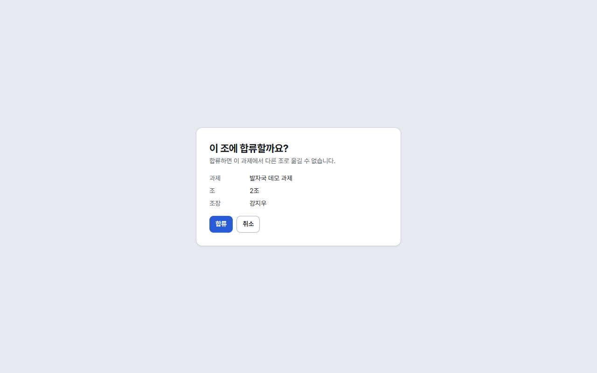

- 초대 링크를 연 학생이 과제 제목, 조 이름, 조장 이름만 보고 "합류"를 누름. 조원 목록, 건수는 보여 주지 않음
- 로그인 전이면 로그인한 뒤 이 화면으로 돌아옴
- 한 학생은 같은 과제에서 한 조에만 들어감. 이미 그 과제의 조에 있거나 링크가 무효면 미리보기에서 합류와 같은 오류를 보여 줌

</details>

<details>
<summary><b>9. 조장 교체 (교수)</b></summary>

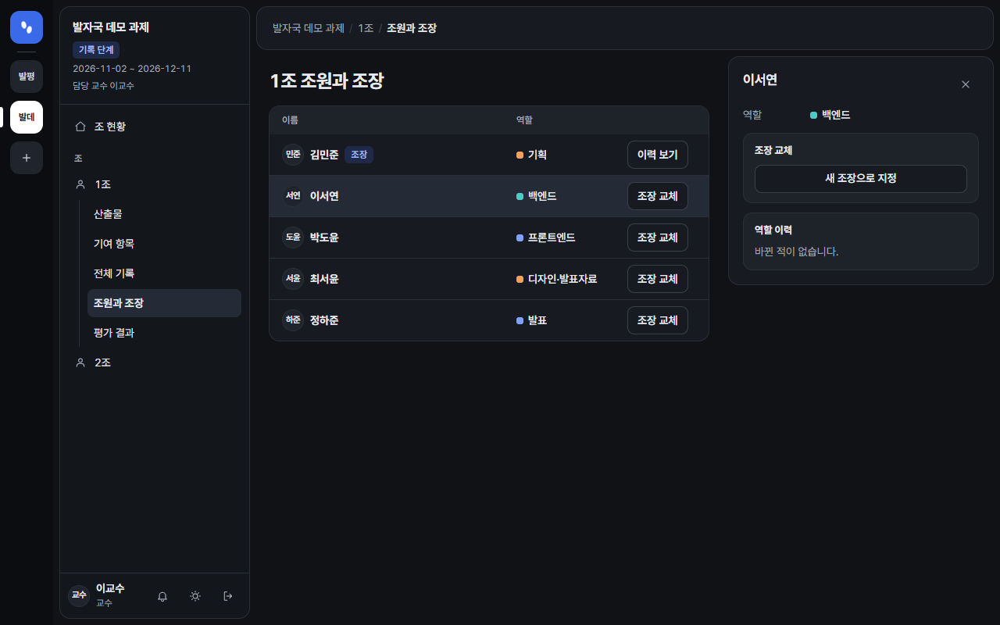

- 과제를 만든 교수만 기록 단계에서 바꿈. 조원을 고르고 "새 조장으로 지정"을 누른 뒤 한 번 더 확인함
- 이전 조장은 일반 조원으로 남고 역할과 기록은 그대로임
- 이전 조장, 새 조장, 바뀐 시각을 이력으로 남김. 조장 줄의 "이력 보기"로 교체 이력을 봄
- 조장은 조마다 한 명. 데이터베이스 인덱스로도 막음

</details>

<details>
<summary><b>10. 산출물</b></summary>

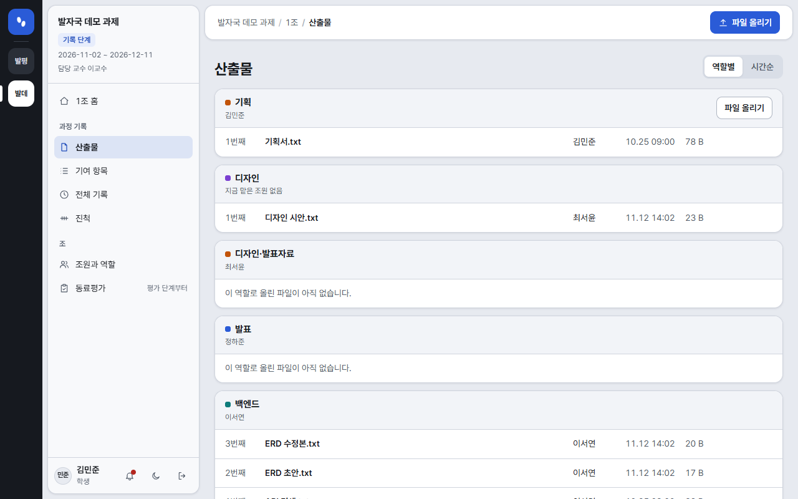

- 역할이 배정된 조원이 "파일 올리기"로 올림. 20MB까지
- 고친 파일도 덮어쓰지 않고 새로 올림. "백엔드 1번째, 2번째…"처럼 역할별 순번이 붙음
- "역할별"과 "시간순"으로 바꿔 봄. 역할별 보기에는 지금 그 역할을 맡은 조원과, 이전 역할명으로 올린 파일이 따로 보임
- 파일 본문은 MinIO에, 데이터베이스에는 위치·이름·크기만 저장함

</details>

<details>
<summary><b>11. 산출물 상세와 완료확인</b></summary>


- 줄을 누르면 오른쪽에 역할·순번, 올린 사람, 올린 시각, 크기, "내려받기"가 열림
- 삭제: 올린 조원 본인만 기록 단계에서 함. 파일 본문만 지우고 줄은 "삭제됨"과 삭제 시각으로 남음. 내려받기는 안 됨
- 완료확인(R-3): 올린 조원이 아닌 조원이 "이 기록을 확인했다"를 한 건씩 남김
  - 한 조원의 유효한 확인은 한 기록에 하나. 확인한 본인만 취소하고, 취소해도 이력에 남음
  - 삭제된 산출물은 새로 확인할 수 없고 이전 확인은 남음
  - 확인 건수는 세지 않음. 교수는 이력만 봄

</details>

<details>
<summary><b>12. 기여 항목</b></summary>


- 회의 진행, 자료 취합처럼 파일이 남지 않는 일의 기록(R-2)
- 조장이 "항목 등록"으로 항목명과 담당 조원 한 명을 정함. 조장 자신도 담당이 될 수 있음. 담당 조원에게 알림이 감
- 담당 조원 본인이 메모와 함께 완료 보고를 한 번만 함. 보고한 뒤 고칠 수 없음. 같은 조의 다른 조원에게 알림이 감
- 조장은 보고 전 항목만 취소함. 취소한 항목은 "취소됨"으로 남음
- "전체 / 보고 전 / 보고됨 / 취소됨"으로 걸러 봄
- 보고된 항목은 담당 조원이 아닌 조원이 완료확인함(오른쪽 아래)

</details>

<details>
<summary><b>13. 전체 기록</b></summary>


- 조에 쌓인 기록을 한 줄씩 있는 그대로 보여 줌(V-1). 조원과 과제를 만든 교수가 두 단계 모두 봄
- 줄마다 누가, 무엇을(산출물 업로드·삭제, 기여 항목 등록·보고·취소, 완료확인·취소, 역할 지정·변경, 조장 교체), 언제
- "시간순"과 "조원별"로 바꿔 봄
- 삭제와 취소는 줄을 지우지 않고 한 줄 더함. 동료평가 제출과 임시 저장은 넣지 않고, 건수도 없음

</details>

<details>
<summary><b>14. 진척</b></summary>


- 조장과 조원이 봄(R-4). 과제 기간(시작일~종료일) 위에 역할마다 파일을 올린 시점을 점으로 찍음
- 역할마다 마지막 업로드 시각과 파일 이름을 함께 보여 줌
- 기간 밖에 올린 파일은 줄 양 끝에 네모로 놓음(화면의 기획·백엔드 왼쪽 끝은 과제 시작 전에 올린 시작 데이터). 삭제된 파일도 올린 기록으로 남김
- 진척률과 건수는 없음. 동료평가 화면의 고정 문구 2개를 함께 둠

</details>

<details>
<summary><b>15. 동료평가와 근거 패널</b></summary>


- 평가 단계에서만 함(E-2). 같은 조에서 자신을 뺀 전원에 대해 6개 항목을 1~5점으로 매기고, 의견은 써도 되고 비워도 됨
- 항목 문장은 신태섭(2018) 행동기준평정척도. 5점·3점·1점의 행동 기준을 함께 보여 줌
- 위쪽 조원 칸에서 평가할 조원을 고름. 칸마다 "입력 중", "미입력" 같은 입력 상태가 보임
- 임시 저장: 일부만 채워도 저장됨. 본인만 보고 교수에게 보이지 않음. 제출하면 지움
- 제출: 전원·전 항목을 채워야 됨. 제출한 평가는 고칠 수 없음
- 조원끼리는 서로의 평가를 볼 수 없음. 화면 맨 위에 그 안내를 고정함
- 근거 패널(E-1, 오른쪽): 고른 조원이 올린 산출물, 맡은 기여 항목과 보고 메모, 그 기록에 남은 완료확인, 그 조원이 남긴 완료확인을 종류별로 보여 줌
  - 삭제되거나 취소된 기록도 빼지 않고, 건수는 없음
  - 조원은 평가 단계에서만, 과제를 만든 교수는 모든 단계에서 봄

</details>

<details>
<summary><b>16. 평가 결과 (교수)</b></summary>


- 과제를 만든 교수만 봄(V-2). 조원은 제출한 본인도 볼 수 없음
- "제출 현황": 조원마다 제출함·미제출과 제출 시각. 임시 저장은 미제출임
- 대상 조원을 고르면 평가자마다 6개 항목 점수와 의견을 입력된 그대로 보여 줌. 합계, 평균, 순위, 제출 건수는 없음
- 오른쪽에 대상 조원의 근거 패널을 함께 띄움
- "CSV 내려받기"(X-5): 조 단위. 열은 평가자, 대상, 항목 6개, 의견, 제출 시각. 엑셀에서 한글이 깨지지 않게 하고(UTF-8 BOM), 수식으로 읽힐 글자로 시작하는 이름·의견은 앞에 `'`를 붙임

</details>

<details>
<summary><b>17. 알림</b></summary>

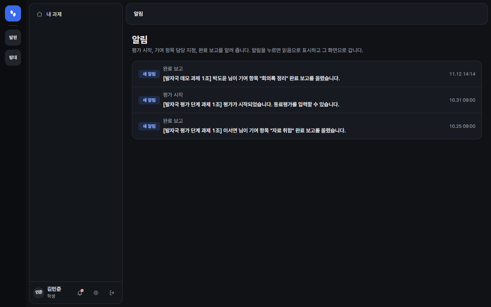

- 평가 시작, 기여 항목 담당 지정, 완료 보고 때 받을 회원마다 한 줄씩 남김(X-6)
- 화면을 열 때 불러옴. 실시간 전송은 없음
- 누르면 읽음으로 표시하고 그 화면으로 감. 회원 본인 것만 봄
- 점수, 평가 의견, 보고 메모, 안 읽은 개수는 담지 않고, 알림은 지우지 않음

</details>

<details>
<summary><b>화면 밖의 기능</b></summary>

- X-7 400 응답에 틀린 칸 담기: 입력값이 틀리면 오류 문장 끝에 어느 칸이 왜 틀렸는지 적음(예: "title: 비어 있습니다"). 응답 모양은 그대로임
- O-1 스키마 관리: Flyway migration이 테이블을 만들고 서버를 다시 켜도 기록이 남음. "유효한 완료확인은 하나", "조장은 조마다 한 명"을 데이터베이스 인덱스로도 막음
- O-2 운영 설정 분리: 환경 변수 `SPRING_PROFILES_ACTIVE=prod` 하나로 운영 설정을 켬
  - 시작 데이터와 이메일·비밀번호 로그인이 꺼짐
  - 비밀값이 저장소에 공개된 기본값이면 서버가 켜지지 않음
  - 환경 변수 없이 켜면 지금처럼 개발 설정임. CORS 허용 주소는 `CORS_ALLOWED_ORIGINS`로 바꿈
- O-3 배포 구성: Docker compose 기반 로컬 실행 묶음(2026.11.12 관리자 결정). `docs/getting-started.md`의 "제출용 실행 묶음"과 `docs/bundle.md`
- O-4 백업·복구: `infra/backup`의 스크립트로 DB와 올린 파일을 같은 시점의 묶음으로 백업하고, 빈 환경에만 되살림. 데이터가 있는 곳에는 덮어쓰지 않고 멈춤. `docs/backup-restore.md`
- O-5 테스트 분리와 보강: 업무 규칙마다 통합 테스트(`backend/src/test`의 `XxxRuleTests`)를 둠. 테스트는 같은 PostgreSQL의 전용 스키마에서 돌아 개발 데이터를 지우지 않음
- O-6 CI: main push와 PR마다 GitHub Actions(`.github/workflows/ci.yml`)가 백엔드 빌드·테스트, 화면 빌드·lint를 돌림
- O-7 주인 없는 파일 정리: 업로드 중 데이터베이스 저장이 실패하면 MinIO에 올린 파일을 지움
- O-8 상태 확인과 로그
  - `GET /actuator/health`를 token 없이 부르면 서버와 데이터베이스가 살아 있는지 `UP`/`DOWN`만 돌려줌. 다른 actuator 주소는 닫혀 있음
  - 로그는 `docker logs`로 읽고, 운영 설정은 SQL을 찍지 않음. 비밀값, token, 이메일, 평가 점수·의견은 로그에 남기지 않음

</details>

## 빠른 시작

- 필요한 것: Docker Desktop(Compose v2.24 이상). Java, Node.js는 없어도 됨
- 포트 5173, 8080, 5432, 9000, 9001을 씀. 같은 포트를 쓰는 다른 서버는 먼저 끌 것

```powershell
git clone https://github.com/Pyrite9/footprint-demo.git
cd footprint-demo
docker compose up -d --build
```

- 처음에는 이미지를 만드느라 몇 분 걸림
- 화면 http://localhost:5173 을 열고 "시작 계정으로 로그인 (개발·백업용)"을 펼쳐 아래 계정으로 들어감. 비밀번호는 모두 `pass1234`
- 끌 때는 `docker compose down`. 올린 파일과 제출한 평가는 다시 켜도 남음

| 계정 | 이름 | 보이는 것 |
|---|---|---|
| `professor@example.com` | 이교수 | 과제 생성, 조 현황, 평가 시작, 조장 교체, 평가 결과 |
| `student01@example.com` | 김민준 | 데모 과제 1조 조장. 초대 링크, 역할 배정, 기여 항목 등록 |
| `student02@example.com` | 이서연 | 1조 조원. 산출물 업로드, 완료확인, 평가 단계 과제의 동료평가 |
| `student10@example.com` | 임지아 | 개인정보 고지에 아직 동의하지 않은 계정 |

- 전체 계정과 시작 과제는 `backend/README.md`의 "시작 계정", "시작 과제와 조"
- 실행 방법 세 가지(제출용 실행 묶음, 한 번에 실행, 개발할 때), 켜기 전에 확인할 것, 비밀값은 [`docs/getting-started.md`](docs/getting-started.md)
- 백엔드 없이 화면만 돌려 보려면 가짜 API를 씀. [`frontend/README.md`](frontend/README.md)

## 기술 스택

| 쪽 | 쓴 것 |
|---|---|
| 백엔드 | Java 21, Spring Boot 3.5.16, Spring Data JPA, Spring Security(JWT, jjwt 0.13.0), Flyway, Gradle 8.14.3 |
| 데이터베이스 | PostgreSQL 17 |
| 파일 저장 | MinIO(S3 호환). 코드는 AWS SDK v2의 S3 API로만 접근 |
| 로그인 | Google ID token 검증(google-api-client), 학교 도메인 제한 |
| 프론트엔드 | Node.js 24, React 19, Vite 8, React Router 7, JavaScript(TypeScript 아님) |
| 가짜 API | json-server 0.17.4. 백엔드 없이 화면만 돌릴 때 씀 |
| 실행·배포 | Docker Compose(백엔드, nginx, PostgreSQL, MinIO), GitHub Actions CI |

**영리한 코드보다 따라 읽을 수 있는 코드**

- 팀원 6명 전원이 Spring Boot·React 초심자라서 둔 기준
- 안 쓰는 것: MapStruct, QueryDSL, 상태 관리 라이브러리, 공통 부모 클래스, 공통 응답 감싸기 클래스, AOP 권한 검사
- 권한 검사는 `TeamAccessChecker`를 Service에서 직접 불러 눈에 보이게 함
- 구조 그림(전체 구조, JWT 흐름, 프론트엔드·백엔드 구조)은 [`docs/architecture.md`](docs/architecture.md)

<details>
<summary><b>폴더 구조</b></summary>

```
backend/    Spring Boot. 패키지 com.footprint.backend
  controller/  요청을 받고 Entity를 응답 DTO로 바꿈 (XxxResponse.from)
  service/     업무 규칙과 권한 검사. Entity를 돌려줌
  repository/  JPA
  entity/      회원, 과제, 조, 조 참여, 역할 이력, 조장 이력, 산출물, 기여 항목, 완료확인, 평가, 평가 임시 저장, 알림 (12개)
  dto/         record. 요청 하나에 DTO 하나
  exception/   GlobalExceptionHandler 한 곳에서 처리. 응답은 ApiErrorResponse { code, message }
  security/    JWT 발급·검증 필터, 구글 ID token 검증
  config/      SecurityFilterChain, CORS, S3, 시작 데이터(DataInitializer)
frontend/   React
  src/pages/       데이터를 불러오고 state를 가짐
  src/components/  props로 받아 그림
  src/api/         fetch는 여기에만. 공통 함수 client.js를 거침
  src/constants/   동료평가 6개 항목 문장, 회원 유형, 과제 단계, 개인정보 고지 초안
  mock/            가짜 API(middleware.cjs). 응답 모양을 실제 API와 똑같이 맞춤
infra/      docker-compose.yml(PostgreSQL, MinIO), .env.example
  backup/   백업·복구 스크립트(Windows .ps1, macOS·Linux .sh). 만든 묶음은 bundles/에 쌓이고 저장소에 올라가지 않음
  bundle/   제출용 실행 묶음. make-bundle.ps1(만드는 스크립트), template/(묶음에 들어갈 파일 원본). 결과 out/은 저장소에 올라가지 않음
docs/       실행 안내, 구조 그림, ERD, API 명세, Postman 모음, 작업 기록, 노트북 설정 지시서, 백업·복구 안내, 실행 묶음 안내
  assets/       README 로고
  screenshots/  README "화면"에 쓰는 화면 사진
docker-compose.yml  한 번에 실행(백엔드, nginx, infra의 PostgreSQL·MinIO)
.github/workflows/ci.yml  main push와 PR마다 빌드·테스트·lint를 돌림
TODO.md     남은 일, 완성 범위와 규칙
```

</details>

## 프로젝트 상태

- 2026.11.12 기준 업무 기능도 및 업무 기술서 v1.3의 기능 15개, 단위 업무 29개와 고른 추가 기능이 모두 됨. 구현 순서 21개가 끝나 만들 기능은 남지 않음
- 새로 clone 한 폴더에서 `docker compose up -d --build` 한 번으로 처음부터 끝까지 실행하는 것까지 확인
- 제출용 실행 묶음(O-3)을 USB에 담음. 저장소 없이 Docker Desktop만 있는 PC에서 인터넷 없이 켜짐
- 남은 것(자세히는 `TODO.md` 맨 위 "남은 일 한눈에")
  - 관리자 작업: 구글 로그인 동의 화면(Google Cloud), 개인정보 고지 문구와 보관 기간의 학교·담당 교수 확인
  - 확인하지 못한 것: 강단 PC와 macOS에서 묶음 실행
- 만들지 않는 것: 점수 자동 계산, 평균, 순위, 진척률, LLM 기능
- 일정: 11.16 조원 코드 합류, 12.11 학기 발표, 12.15 PBL 결과물 제출. 날짜는 범위를 정하는 기준이 아님

## 문서

| 문서 | 내용 |
|---|---|
| [`docs/getting-started.md`](docs/getting-started.md) | 실행 방법 세 가지, 켜기 전에 확인할 것, 비밀값 |
| [`docs/architecture.md`](docs/architecture.md) | 구조 그림. 전체 구조, JWT 흐름, 프론트엔드·백엔드 구조. **코드를 처음 읽는다면 여기부터** |
| [`docs/erd.md`](docs/erd.md) | 데이터 구조. 엔티티 12개의 연결, 열마다 비고, 제약 |
| [`docs/api-draft.md`](docs/api-draft.md) | API 명세. 코드보다 이 문서를 먼저 씀 |
| [`docs/postman/`](docs/postman/) | API를 데모 흐름 순서로 모은 Postman 모음과 쓰는 방법 |
| [`docs/bundle.md`](docs/bundle.md) | 제출용 실행 묶음을 만들고 USB에 담는 방법 |
| [`docs/backup-restore.md`](docs/backup-restore.md) | DB와 올린 파일을 한 묶음으로 백업하고 빈 환경에 되살리는 방법 |
| [`docs/worklog.md`](docs/worklog.md) | 작업 기록. 단위 업무마다 결정과 이유, 초심자가 막힐 곳, 채운 가정 |
| [`docs/laptop-setup.md`](docs/laptop-setup.md) | 다른 컴퓨터(Arch Linux 노트북)에 이 저장소를 올려 작업하는 설정 |
| [`backend/README.md`](backend/README.md) | 서버 실행, 테스트, 스키마, 운영 설정, 시작 계정, 구글 로그인 |
| [`frontend/README.md`](frontend/README.md) | 화면 실행, 가짜 API |
| [`TODO.md`](TODO.md) | 남은 일, 완성 범위와 규칙, 알려진 한계, 조원과 함께 일할 때 |
| [`CLAUDE.md`](CLAUDE.md) | 코드 생성 규칙. 스택, 계층, 명명, 금지 목록을 AI 도구와 사람이 같이 지키는 기준 |

## 팀과 기여

- 6명 조별과제 팀의 PBL 결과물. 조원 코드는 이 저장소의 같은 파일에 끼워 넣음
- 함께 일하는 규칙(처음 읽을 문서, API를 바꿀 때의 순서, 결정 기록)은 `TODO.md` 6절 "조원과 함께 일할 때"
- 업무 규칙과 코드 규칙은 `CLAUDE.md`. 규칙을 바꾸려면 먼저 정하고 문서를 고친 뒤 코드를 고침

## 라이선스

- MIT. [`LICENSE`](LICENSE) 참고
