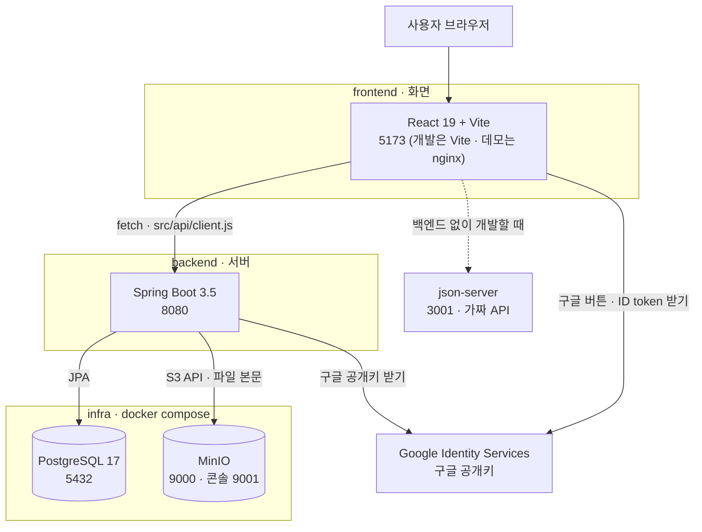
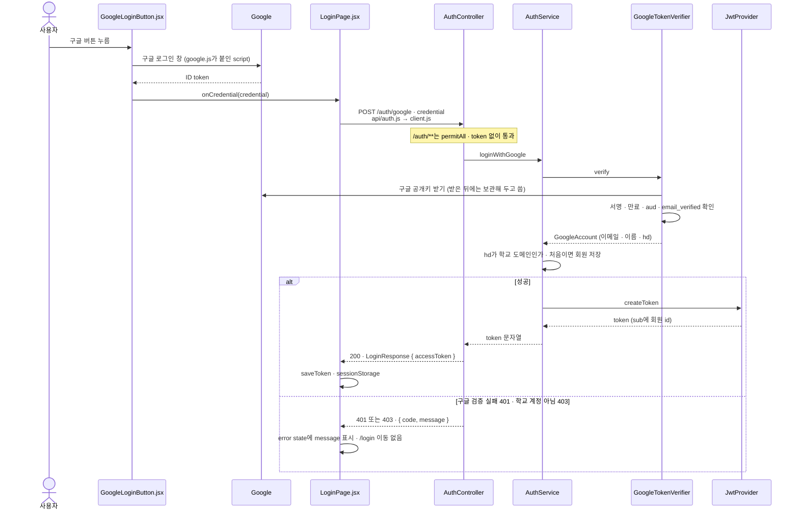
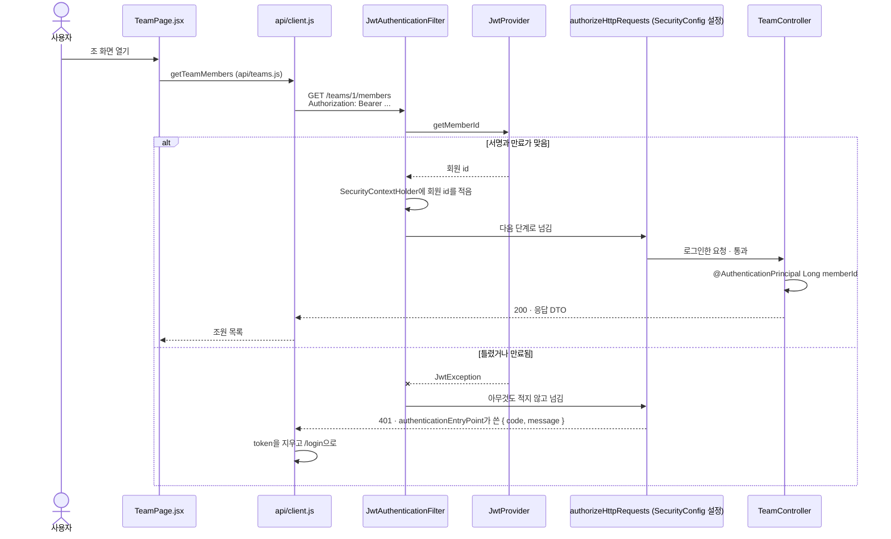
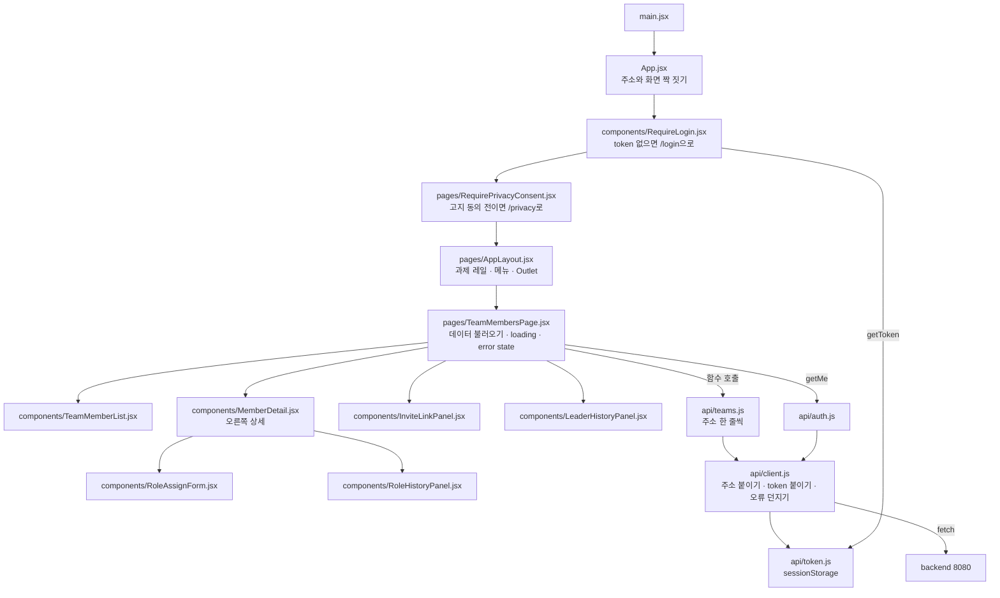
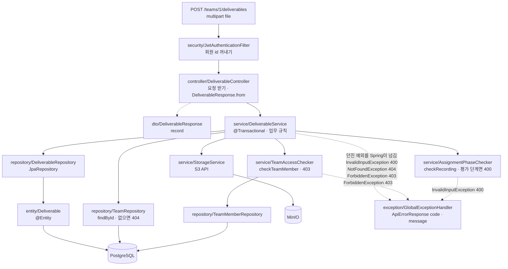

# 구조 그림

코드를 처음 읽는 사람이 먼저 볼 그림. GitHub가 Mermaid를 바로 그려 주므로 따로 그림 파일을 두지 않음.

- 그림의 글자는 실제 파일·클래스 이름과 같게 맞춤. 그림에서 본 이름으로 파일을 찾을 수 있어야 함
- 코드를 고치면 이 문서도 같은 작업 안에서 고칠 것
- API 주소와 응답 모양은 `api-draft.md`, 데이터 구조는 `erd.md`, 코드 규칙은 `../CLAUDE.md`

## 1. 전체 구조

사람이 브라우저를 열었을 때 어떤 프로그램이 몇 번 포트에서 무엇을 맡는지.

- 화면은 **PostgreSQL이나 MinIO를 직접 부르지 않음.** 모든 데이터는 8080을 거침
- 파일 본문만 MinIO에 있고, 파일 위치·이름·크기는 PostgreSQL에 있음
- PostgreSQL의 테이블은 백엔드가 켜질 때 Flyway가 `backend/src/main/resources/db/migration`의 SQL 파일로 만듦. 이미 적용한 파일은 다시 실행하지 않아서 백엔드를 다시 켜도 데이터가 남음(O-1). 시작 데이터는 빈 데이터베이스에서만 들어감
- 데모(맨 위 `docker-compose.yml`)에서는 nginx가 컨테이너 안 80번에서 듣고, 밖으로는 5173으로 열림. 사람은 두 경우 모두 5173으로 접속함
- docker compose로 켠 포트는 `127.0.0.1`에만 열어 둠. 같은 네트워크의 다른 컴퓨터에서는 접속되지 않음. 단, 개발 중 `gradlew bootRun`으로 직접 켠 백엔드 8080은 모든 주소에 열림(`application.yml`에 `server.address`가 없음)
- 가짜 API(3001)는 Java와 Docker 없이 화면만 만들 때 쓰는 갈래. 실제 API와 응답 모양이 같음
- 백엔드는 환경 변수 없이 켜면 개발 설정, `SPRING_PROFILES_ACTIVE=prod`면 운영 설정임(O-2). 운영 설정은 `application.yml` 위에 `application-prod.yml`을 덮어써서 시작 데이터와 이메일·비밀번호 로그인을 끄고, 켜기 전에 `ProductionSettingsChecker`가 비밀값을 검사함. 화면이 부를 수 있는 주소(CORS)는 `CORS_ALLOWED_ORIGINS`
- 백엔드의 상태 확인 주소는 `GET /actuator/health` 하나임(O-8). token 없이 `UP`/`DOWN`만 돌려주고 데이터베이스에 닿는지 봄(MinIO는 보지 않음). 맨 위 `docker-compose.yml`의 backend healthcheck가 이 주소를 부름. 다른 actuator 주소는 열지 않음
- 로그는 파일 없이 표준 출력으로만 나감. docker compose로 켜면 `docker logs footprint-demo-backend`로 읽음. 운영 설정은 SQL을 찍지 않음

## 2. JWT 흐름

로그인한 사람이 누구인지 요청마다 어떻게 알아내는지. 서버는 session을 만들지 않음. 그림 두 장으로 나눔.

### 2-1. 로그인하고 token 받기

- 서버는 ID token을 구글에 보내지 않음. 구글 공개키만 받아 와서 서명은 서버 안에서 확인함. 이메일·이름·`hd`는 ID token 안에 들어 있음
- 로그인 실패 때 `/login`으로 다시 보내지 않는 이유: `LoginPage`가 요청 전에 `removeToken()`을 부름. `client.js`는 "token을 보냈는데 401"일 때만 token을 지우고 이동함
- 이메일·비밀번호 로그인(`POST /auth/login`)은 `AuthController.login` → `AuthService.login`. 구글 검증·도메인 검사·회원 저장 없이 BCrypt 비교만 함. 시작 계정 전용이고, 구글로 만든 회원(비밀번호 없음)은 이 방법으로 로그인할 수 없음

### 2-2. 그 다음 요청마다

- 막는 일은 filter가 아님. `SecurityConfig`가 서버를 켤 때 설정한 `authorizeHttpRequests` 단계가 함. filter는 "누가 보냈는지"만 적어 둠
- token이 아예 없으면 요청이 서버까지 가지 않음. `RequireLogin.jsx`가 화면 단계에서 `/login`으로 보냄
- token에 `memberType`도 들어 있지만 **참고용.** 권한 검사는 Service가 데이터베이스의 값으로 함
- token은 `sessionStorage`에 둠. 탭마다 따로라서 한 탭은 교수, 다른 탭은 학생으로 동시에 로그인할 수 있음

## 3. 프론트엔드 구조

화면 하나를 그릴 때 어떤 파일을 거치는지. 조원과 역할 화면(`/teams/:teamId/members`)을 예로 둠.

- **page만 데이터를 불러오고 state를 가짐.** component는 props로 받아 그리기만 함. 예외 하나: `GoogleLoginButton.jsx`는 구글 script를 불러옴(서버 데이터는 아님)
- `fetch`는 `src/api/` 밖에 쓰지 않음. 모든 호출이 `client.js` 한 곳을 거침
- `client.js`는 실패하면 `status`와 `code`를 담은 오류를 던짐. page의 `.catch`가 그것을 받아 `error` state에 넣음
- 비동기는 `.then` 방식으로 통일. `async`/`await`를 섞지 않음
- 개인정보 고지에 동의하기 전에는 `RequirePrivacyConsent.jsx`가 `getMe`의 `privacyConsentedAt`을 보고 `/privacy`(`PrivacyNoticePage.jsx`)로 보냄. 서버는 동의 전 요청을 막지 않음(X-2). 내 정보를 불러오고 state를 가지므로 `RequireLogin.jsx`와 달리 `pages/`에 둠
- 화면을 하나 더할 때 손대는 곳: `App.jsx`에 `Route` 한 줄, `pages/`에 page 하나, 필요하면 `api/`에 함수 하나
- `src/constants/`는 화면에 그대로 쓰는 고정 문장. 동료평가 6개 항목과 점수 기준(`peerEvaluation.js`)이 여기 있고 **고치지 않음**
- 개인정보 고지 문구와 보관 기간(`privacyNotice.js`)은 학교·담당 교수 확인 전 초안임. 확인 뒤 이 파일만 고침

## 4. 백엔드 구조

요청 하나가 Controller부터 데이터베이스까지 내려가는 길. 산출물 업로드를 예로 둠.

- 한 방향으로만 내려감. **Service가 Controller를 부르거나 Repository가 Service를 부르는 일은 없음**
- Service는 Entity를 돌려주고, Entity → DTO 변환은 Controller에서 `XxxResponse.from(entity)`로 함(여기서는 `DeliverableResponse.from`)
- 예외는 Controller가 handler를 부르는 게 아님. Service에서 던진 예외가 Controller를 지나 위로 올라가면 Spring이 `GlobalExceptionHandler`로 넘김
- 400이 Service보다 먼저 나는 경우: 파일 칸이 빠졌거나 20MB를 넘으면 Spring이 Controller 전에 막고, 그 예외도 `GlobalExceptionHandler`가 400 `INVALID_INPUT`으로 바꿈. Service의 `InvalidInputException`은 빈 파일일 때만 남
- 권한 검사는 `TeamAccessChecker`의 메서드 호출로 **코드에 보이게** 함. 어노테이션이나 AOP로 숨기지 않음
- 쓰기 요청의 단계 검사는 권한 다음에 `AssignmentPhaseChecker`의 메서드 호출로 함. 평가 단계면 400 `INVALID_INPUT`
- 오류 응답은 `ApiErrorResponse { code, message }` 하나뿐이고 만드는 곳은 `GlobalExceptionHandler` 한 곳. 다만 Security 단계에서 막힌 401은 Controller에 닿지 않아 `SecurityConfig`가 같은 모양으로 직접 씀
- 업로드는 "MinIO 저장 → 데이터베이스 저장" 순서. 저장 오류가 나면 `DeliverableService`가 올린 파일을 지움. 커밋 단계 실패 때만 파일이 남음(`../TODO.md` "알려진 한계")

### 데이터 구조

엔티티 12개의 연결과 열, 제약은 [`erd.md`](erd.md)에 따로 둠. 테이블을 실제로 만드는 SQL은 `backend/src/main/resources/db/migration`
