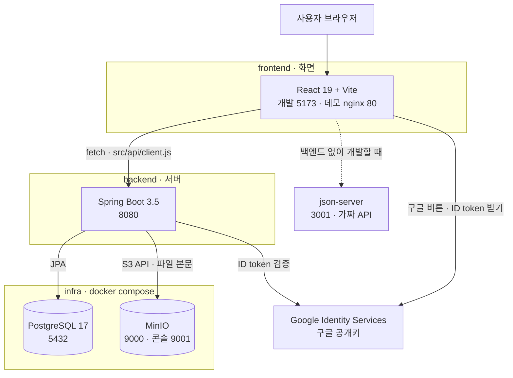
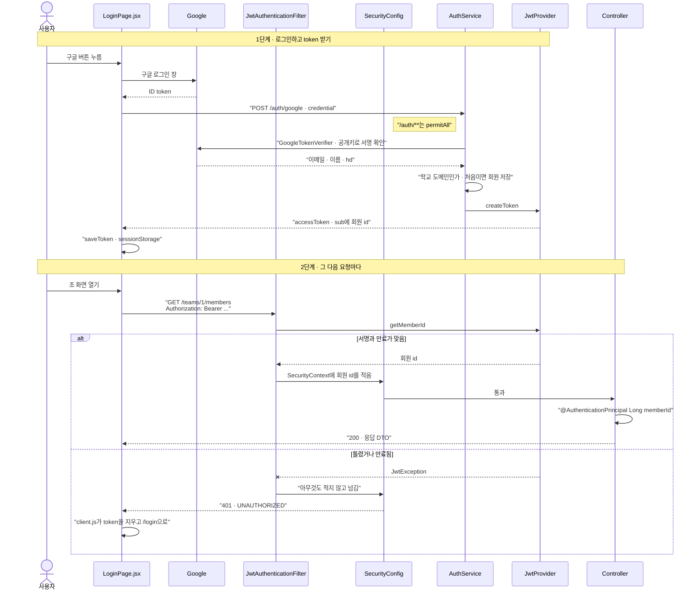
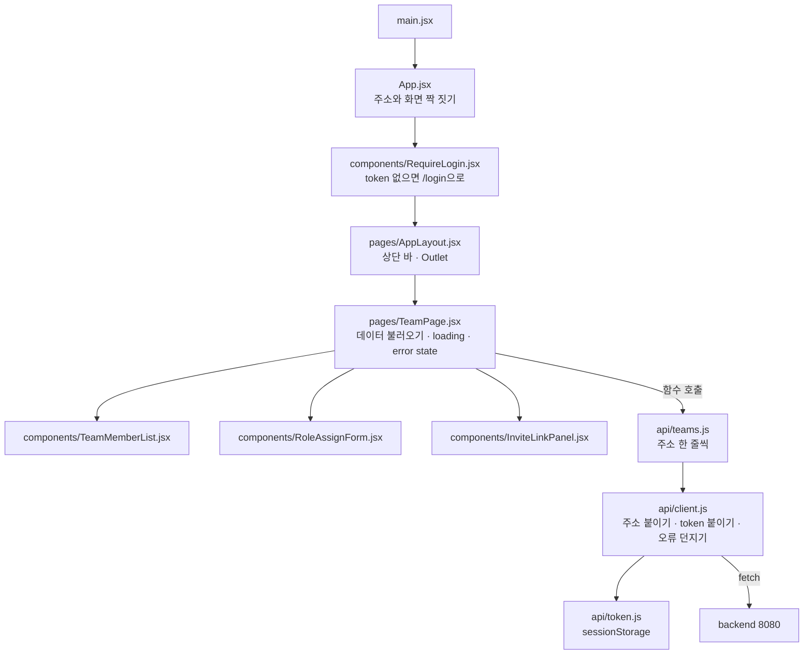
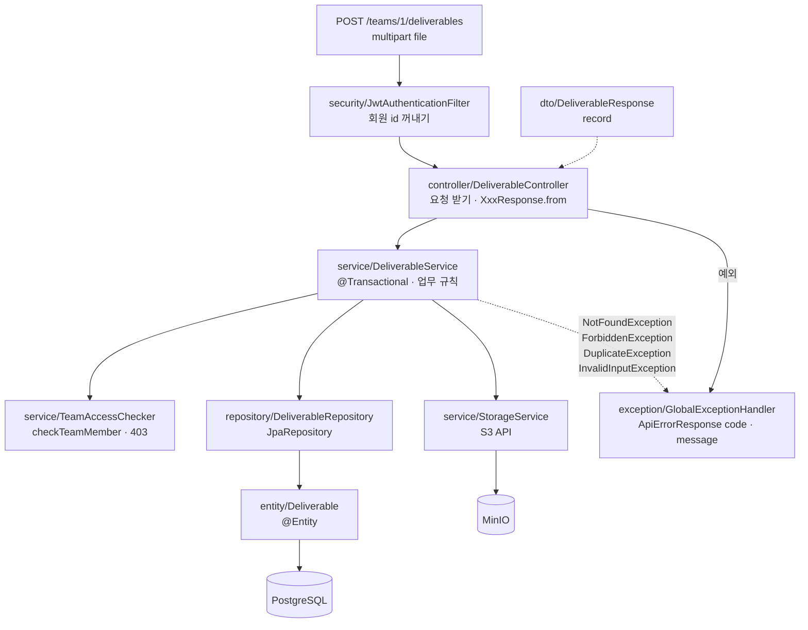
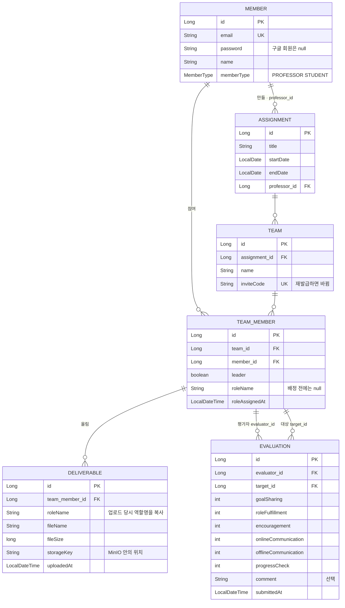

# 구조 그림

코드를 처음 읽는 사람이 먼저 볼 그림 네 장. GitHub가 Mermaid를 바로 그려 주므로 따로 그림 파일을 두지 않음.

- 그림의 글자는 실제 파일·클래스 이름과 같게 맞춤. 그림에서 본 이름으로 파일을 찾을 수 있어야 함
- 코드를 고치면 이 문서도 같은 작업 안에서 고칠 것
- API 주소와 응답 모양은 `api-draft.md`, 코드 규칙은 `../CLAUDE.md`

## 1. 전체 구조

사람이 브라우저를 열었을 때 어떤 프로그램이 몇 번 포트에서 무엇을 맡는지.

- 화면은 서버에게 **직접 PostgreSQL이나 MinIO를 부르지 않음.** 모든 데이터는 8080을 거침
- 파일 본문만 MinIO에 있고, 파일 위치·이름·크기는 PostgreSQL에 있음
- 포트는 `127.0.0.1`에만 열어 둠. 같은 네트워크의 다른 컴퓨터에서는 접속되지 않음
- 가짜 API(3001)는 Java와 Docker 없이 화면만 만들 때 쓰는 갈래. 실제 API와 응답 모양이 같음

## 2. JWT 흐름

로그인한 사람이 누구인지 요청마다 어떻게 알아내는지. 서버는 session을 만들지 않음.

- 막는 일은 filter가 아니라 `SecurityConfig`의 `authorizeHttpRequests`가 함. filter는 "누가 보냈는지"만 적어 둠
- token에 `memberType`도 들어 있지만 **참고용.** 권한 검사는 Service가 데이터베이스의 값으로 함
- token은 `sessionStorage`에 둠. 탭마다 따로라서 한 탭은 교수, 다른 탭은 학생으로 동시에 로그인할 수 있음
- 이메일·비밀번호 로그인(`POST /auth/login`)도 같은 1단계를 거침. 구글 대신 BCrypt 비교만 다름

## 3. 프론트엔드 구조

화면 하나를 그릴 때 어떤 파일을 거치는지. 조 화면(`/teams/:teamId`)을 예로 둠.

- **page만 데이터를 불러오고 state를 가짐.** component는 props로 받아 그리기만 함
- `fetch`는 `src/api/` 밖에 쓰지 않음. 모든 호출이 `client.js` 한 곳을 거침
- `client.js`는 실패하면 `status`와 `code`를 담은 오류를 던짐. page의 `.catch`가 그것을 받아 `error` state에 넣음
- 비동기는 `.then` 방식으로 통일. `async`/`await`를 섞지 않음
- 화면을 하나 더할 때 손대는 곳: `App.jsx`에 `Route` 한 줄, `pages/`에 page 하나, 필요하면 `api/`에 함수 하나
- `src/constants/`는 화면에 그대로 쓰는 고정 문장. 동료평가 6개 항목과 점수 기준(`peerEvaluation.js`)이 여기 있고 **고치지 않음**

## 4. 백엔드 구조

요청 하나가 Controller부터 데이터베이스까지 내려가는 길. 산출물 업로드를 예로 둠.

- 한 방향으로만 내려감. **Service가 Controller를 부르거나 Repository가 Service를 부르는 일은 없음**
- Service는 Entity를 돌려주고, Entity → DTO 변환은 Controller에서 `XxxResponse.from(entity)`로 함
- 권한 검사는 `TeamAccessChecker`의 메서드 호출로 **코드에 보이게** 함. 어노테이션이나 AOP로 숨기지 않음
- 오류 응답은 `ApiErrorResponse { code, message }` 하나뿐이고 만드는 곳은 `GlobalExceptionHandler` 한 곳. 다만 Security 단계에서 막힌 401은 Controller에 닿지 않아 `SecurityConfig`가 같은 모양으로 직접 씀
- 업로드는 "MinIO 저장 → 데이터베이스 저장" 순서. 뒤가 실패하면 파일만 남음(`../TODO.md` "알려진 한계")

### 데이터 구조

엔티티 6개. 산출물과 평가는 회원이 아니라 **조 참여**(`TeamMember`)를 가리킴.

- `TEAM_MEMBER`에 `(team_id, member_id)` unique, `EVALUATION`에 `(evaluator_id, target_id)` unique. 두 번 합류·두 번 평가는 409 `DUPLICATE`
- 조장을 따로 두지 않고 조 참여의 `leader`로 표시함. 선택 이유와 열린 부분은 `../TODO.md` "아직 정하지 않은 것"
- `DELIVERABLE.roleName`은 `TEAM_MEMBER.roleName`을 가리키지 않고 **값을 복사해 둔 것.** 나중에 역할이 바뀌어도 산출물 순번이 끊기지 않게 함
- 점수 열은 6개 그대로 저장함. 합계·평균 열은 두지 않음
- 기록 시각(`uploadedAt`, `roleAssignedAt`, `submittedAt`)은 모두 서버가 넣음. 클라이언트가 보낸 시각은 받지 않음
