# 데이터 구조 (ERD)

엔티티와 연결, 제약을 코드 없이 한눈에 보는 문서. GitHub가 Mermaid를 바로 그려 줌

- 기준은 `backend/src/main/java/com/footprint/backend/entity/`. Entity 필드를 바꾸면 이 문서도 같은 작업 안에서 고칠 것
- 실행 구성과 요청의 길은 `architecture.md`, 아직 없는 열(`Member.privacyConsentedAt`)은 `../TODO.md` "늘어나는 데이터"

엔티티 12개. 산출물과 평가, 기여 항목의 담당, 완료확인한 조원은 회원이 아니라 **조 참여**(`TeamMember`)를 가리킴. 알림만 회원을 가리킴.

```mermaid
erDiagram
    MEMBER ||--o{ ASSIGNMENT : "만듦 · professor_id"
    MEMBER ||--o{ TEAM_MEMBER : "참여"
    ASSIGNMENT ||--o{ TEAM : "assignment_id"
    ASSIGNMENT ||--o{ TEAM_MEMBER : "assignment_id"
    TEAM ||--o{ TEAM_MEMBER : "team_id"
    TEAM_MEMBER ||--o{ ROLE_HISTORY : "이전 역할"
    TEAM ||--o{ LEADER_HISTORY : "team_id"
    TEAM_MEMBER ||--o{ LEADER_HISTORY : "이전 조장 previous_leader_id"
    TEAM_MEMBER ||--o{ LEADER_HISTORY : "새 조장 new_leader_id"
    TEAM_MEMBER ||--o{ DELIVERABLE : "올림"
    TEAM ||--o{ CONTRIBUTION : "기록함"
    TEAM_MEMBER ||--o{ CONTRIBUTION : "담당함"
    TEAM_MEMBER ||--o{ CONFIRMATION : "확인함 confirmer_id"
    DELIVERABLE |o--o{ CONFIRMATION : "deliverable_id"
    CONTRIBUTION |o--o{ CONFIRMATION : "contribution_id"
    TEAM_MEMBER ||--o{ EVALUATION : "평가자 evaluator_id"
    TEAM_MEMBER ||--o{ EVALUATION : "대상 target_id"
    TEAM_MEMBER ||--o{ EVALUATION_DRAFT : "평가자 evaluator_id"
    TEAM_MEMBER ||--o{ EVALUATION_DRAFT : "대상 target_id"
    MEMBER ||--o{ NOTIFICATION : "받음 recipient_id"
    TEAM ||--o{ NOTIFICATION : "team_id"

    MEMBER {
        Long id PK "회원 번호"
        String email UK "로그인 아이디 · 같은 이메일 두 번 저장 불가"
        String password "BCrypt로 바꾼 값 · 구글 회원은 null"
        String name "화면에 보이는 이름"
        MemberType memberType "PROFESSOR 교수 · STUDENT 학생 · 교수만 과제 생성, 학생만 조 합류"
    }
    ASSIGNMENT {
        Long id PK "과제 번호"
        String title "과제 제목"
        LocalDate startDate "과제 시작일"
        LocalDate endDate "과제 종료일 · 시작일보다 앞이면 400"
        Long professor_id FK "과제를 만든 교수 · 교수 열람 권한 기준"
        AssignmentPhase phase "RECORDING 기록 단계 · EVALUATION 평가 단계 · 되돌릴 수 없음"
        LocalDateTime evaluationStartedAt "평가 시작 시각 · 서버가 기록 · 기록 단계에서는 null"
    }
    TEAM {
        Long id PK "조 번호"
        Long assignment_id FK "이 조가 속한 과제"
        String name "화면에 보이는 조 이름 · 예: 1조"
        String inviteCode UK "초대 링크에 들어가는 코드 · 발급 전 null · 재발급하면 이전 코드 무효"
    }
    TEAM_MEMBER {
        Long id PK "조 참여 번호 · 산출물과 평가가 가리키는 번호"
        Long team_id FK "참여한 조"
        Long assignment_id FK "team의 과제를 복사 · 한 과제 한 조 unique 제약용"
        Long member_id FK "참여한 회원"
        boolean leader "조장이면 true · 조장도 조원으로 함께 등록"
        String roleName "조장이 정한 역할명 · 배정 전에는 null"
        LocalDateTime roleAssignedAt "지금 역할을 지정한 시각 · 바꾸면 새 시각 · 서버가 기록 · 배정 전에는 null"
    }
    ROLE_HISTORY {
        Long id PK "역할 이력 번호"
        Long team_member_id FK "역할이 바뀐 조원의 조 참여"
        String previousRoleName "바뀌기 전의 역할명"
        LocalDateTime previousRoleAssignedAt "바뀌기 전의 역할을 지정한 시각 · 기록 열람의 첫 지정 줄이 씀"
        LocalDateTime changedAt "바뀐 시각 · 서버가 기록"
    }
    LEADER_HISTORY {
        Long id PK "조장 교체 이력 번호"
        Long team_id FK "조장이 바뀐 조"
        Long previous_leader_id FK "이전 조장의 조 참여"
        Long new_leader_id FK "새 조장의 조 참여"
        LocalDateTime changedAt "바뀐 시각 · 서버가 기록"
    }
    DELIVERABLE {
        Long id PK "산출물 번호"
        Long team_member_id FK "올린 조원의 조 참여"
        String roleName "업로드 당시 역할명을 복사 · 역할이 바뀌어도 순번 유지"
        String fileName "올린 파일의 원래 이름 · 다운로드할 때 이 이름으로 내려줌"
        long fileSize "파일 크기(byte)"
        String storageKey "MinIO 안의 위치 · 파일 본문을 꺼낼 때 씀. 삭제한 뒤에도 값은 남음"
        LocalDateTime uploadedAt "올린 시각 · 서버가 기록"
        LocalDateTime deletedAt "삭제 시각 · 서버가 기록. 삭제 전에는 null"
    }
    CONTRIBUTION {
        Long id PK "기여 항목 번호"
        Long team_id FK "이 항목이 속한 조"
        Long assignee_id FK "담당 조원의 조 참여"
        String title "항목명 · 등록한 뒤 고치지 않음"
        LocalDateTime createdAt "등록 시각 · 서버가 기록"
        String reportMemo "완료 보고 메모 · 최대 2000자 · 보고 전에는 null"
        LocalDateTime reportedAt "완료 보고 시각 · 서버가 기록. 보고 전에는 null"
        LocalDateTime canceledAt "취소 시각 · 서버가 기록. 취소 전에는 null"
    }
    CONFIRMATION {
        Long id PK "완료확인 번호"
        Long confirmer_id FK "확인한 조원의 조 참여"
        Long deliverable_id FK "확인한 산출물 · 기여 항목을 확인했으면 null"
        Long contribution_id FK "확인한 기여 항목 · 산출물을 확인했으면 null"
        LocalDateTime confirmedAt "확인 시각 · 서버가 기록"
        LocalDateTime canceledAt "취소 시각 · 서버가 기록. 취소 전에는 null"
    }
    EVALUATION {
        Long id PK "평가 번호"
        Long evaluator_id FK "평가한 조원의 조 참여"
        Long target_id FK "평가받은 조원의 조 참여"
        int goalSharing "목표 공유·협업 · 1~5점"
        int roleFulfillment "역할 수행 · 1~5점"
        int encouragement "격려·도움 · 1~5점"
        int onlineCommunication "온라인 소통 · 1~5점"
        int offlineCommunication "대면 소통 · 1~5점"
        int progressCheck "진행 점검·보충 · 1~5점"
        String comment "조원별 서술 의견 · 선택 · 최대 2000자"
        LocalDateTime submittedAt "제출 시각 · 서버가 기록 · 한 번에 낸 평가는 같은 시각"
    }
    EVALUATION_DRAFT {
        Long id PK "임시 저장 번호"
        Long evaluator_id FK "저장한 조원의 조 참여"
        Long target_id FK "평가 대상 조원의 조 참여"
        Integer goalSharing "목표 공유·협업 · 1~5점 · 고르지 않으면 null"
        Integer roleFulfillment "역할 수행 · 1~5점 · 고르지 않으면 null"
        Integer encouragement "격려·도움 · 1~5점 · 고르지 않으면 null"
        Integer onlineCommunication "온라인 소통 · 1~5점 · 고르지 않으면 null"
        Integer offlineCommunication "대면 소통 · 1~5점 · 고르지 않으면 null"
        Integer progressCheck "진행 점검·보충 · 1~5점 · 고르지 않으면 null"
        String comment "조원별 서술 의견 · 선택 · 최대 2000자"
        LocalDateTime savedAt "저장 시각 · 서버가 기록 · 한 번에 저장한 내용은 같은 시각"
    }
    NOTIFICATION {
        Long id PK "알림 번호"
        Long recipient_id FK "받는 회원 · 본인만 조회하고 읽음 표시함"
        NotificationType type "EVALUATION_STARTED 평가 시작 · CONTRIBUTION_ASSIGNED 담당 지정 · CONTRIBUTION_REPORTED 완료 보고"
        String message "화면에 보일 문장 · 서버가 만듦 · 최대 1000자 · 점수와 의견, 보고 메모는 넣지 않음"
        Long team_id FK "알림이 생긴 조 · 화면이 누르면 갈 곳"
        LocalDateTime createdAt "만든 시각 · 서버가 기록"
        LocalDateTime readAt "읽은 시각 · 서버가 기록. 읽기 전에는 null · 다시 읽어도 처음 시각 유지"
    }
```

- 각 열의 오른쪽 칸은 비고. 그 값이 무엇에 쓰이는지 적음. `id`는 모두 데이터베이스가 자동으로 붙이는 번호(`IDENTITY`)임. `EVALUATION` 점수 열의 항목 이름은 `frontend/src/constants/peerEvaluation.js`의 `name`과 같음
- 열 이름 표기: FK는 데이터베이스 열 이름(`professor_id`), 나머지는 Java 필드 이름(`startDate`)으로 적음. 실제 데이터베이스 열은 snake_case임(`startDate` → `start_date`)
- `TEAM_MEMBER`에 `(assignment_id, member_id)` unique, `EVALUATION`과 `EVALUATION_DRAFT`에 각각 `(evaluator_id, target_id)` unique
- `CONFIRMATION`은 취소한 행이 남아서 일반 unique를 걸 수 없음. 한 조원의 유효한 확인이 하나인 것은 대상 행을 잠그고 `ConfirmationService`가 확인함
- `TEAM_MEMBER.assignment_id`는 `TEAM.assignment_id`와 같은 값. unique 제약은 한 테이블의 열만 쓸 수 있어서, "한 학생은 한 과제에서 한 조"를 DB가 지키도록 복사해 둠. 생성자가 team에서 채우므로 둘이 달라질 수 없음
- 합류: 같은 조에 다시 합류하면 오류 없이 200. 같은 과제의 다른 조에 이미 있으면 Service 검사로 409 `DUPLICATE`. `TEAM_MEMBER`의 unique는 두 요청이 거의 동시에 올 때를 막는 마지막 장치
- 평가: 이미 제출했으면 Service 검사로 409 `DUPLICATE`. 겹치는 제출과 임시 저장은 조 행을 잠가 한 번에 하나씩 처리함. `EVALUATION`의 unique는 마지막 장치
- 조장을 따로 두지 않고 조 참여의 `leader`로 표시함. 결정 기록은 `worklog.md` A-1a 항목, 데이터베이스 제약이 없는 부분은 `../TODO.md` 5절
- `CONFIRMATION`은 대상 열을 산출물과 기여 항목으로 나눠 외래 키 제약을 유지함
- `EVALUATION_DRAFT`를 따로 두어 제출본 `EVALUATION`의 점수를 NOT NULL로 유지함. 제출하면 지우고, 다시 저장하면 행을 지운 뒤 새로 넣음
- `DELIVERABLE.roleName`은 `TEAM_MEMBER.roleName`을 가리키지 않고 **값을 복사해 둔 것.** 나중에 역할이 바뀌어도 산출물 순번이 끊기지 않게 함
- `ROLE_HISTORY`는 역할이 바뀔 때마다 한 줄 쌓임. 첫 지정은 이전 역할이 없어서 남기지 않음. 만든 뒤에는 고치거나 지우지 않음
- `LEADER_HISTORY`는 조장이 바뀔 때마다 한 줄 쌓임. 만든 뒤에는 고치거나 지우지 않음
- 조장이 조마다 한 명인 것은 DB 제약이 아니라 Service가 지킴. 첫 조장은 과제를 만들 때 `AssignmentService`가 조마다 한 명 넣고, 교체는 `TeamService`가 함. 조장 교체와 역할 지정·변경이 같은 조 행을 잠가 차례로 처리함. 그래서 역할 저장이 옛 `leader` 값을 덮어쓰지 않고, 같은 이전 역할이 이력에 두 줄 남지 않음
- `NOTIFICATION`은 조 참여가 아니라 회원을 가리킴. 여러 과제의 알림을 한 목록으로 찾기 때문임. 알림을 만드는 사건 하나에 받는 회원마다 한 줄씩 쌓이고 지우지 않음
- 점수 열은 6개 그대로 저장함. 합계·평균 열은 두지 않음
- 기록 시각(`evaluationStartedAt`, `roleAssignedAt`, `previousRoleAssignedAt`, `changedAt`, `uploadedAt`, `deletedAt`, `createdAt`, `reportedAt`, `canceledAt`, `confirmedAt`, `submittedAt`, `savedAt`, `readAt`)은 모두 서버가 넣음. 클라이언트가 보낸 시각은 받지 않음
